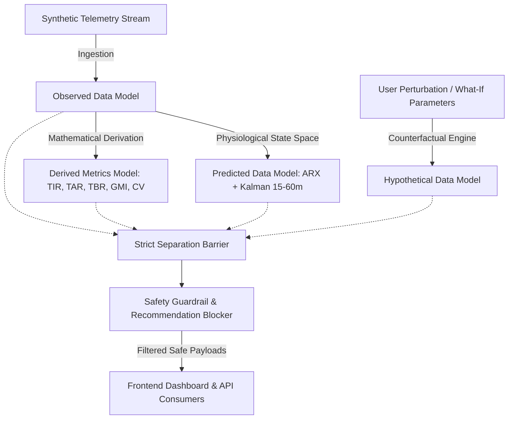

# GlucoTwin AI

> **A Physiological Digital Twin & Metabolic Simulation Platform for Type 1 Diabetes Research & Education**

[](https://www.python.org/downloads/)
[](https://fastapi.tiangolo.com)
[](https://react.dev/)
[]()
[]()

---

## ⚠️ Important Clinical Disclaimer

**GlucoTwin AI is an academic, research, and educational simulation prototype.**
- It operates **exclusively on synthetic patient datasets**.
- It is **NOT** a certified medical device, diagnostic system, or automated insulin delivery (AID) algorithm.
- **Strict Guardrail Rule:** The system will **never** provide insulin doses, medication adjustments, clinical diagnosis, or prescriptive treatment recommendations.
- All hypothetical scenario simulations are for educational exploration and metabolic dynamic modeling only.

---

## 1. Project Overview

GlucoTwin AI builds a computational digital twin of glucose-insulin homeostasis for individuals with Type 1 Diabetes (T1D). By integrating differential-equation physiological models (such as the Bergman Minimal Model) and adaptive statistical state-space estimators (AutoRegressive with Exogenous inputs - ARX, and Kalman filtering), GlucoTwin AI enables:

1. **Continuous Glucose Monitoring (CGM) Telemetry Ingestion:** Processing high-resolution synthetic CGM streams (interstitial glucose in mg/dL).
2. **Standard Glycemic Metrics Analysis:** Computing consensus clinical benchmarks including Time in Range (TIR: 70–180 mg/dL), Time Below Range (TBR: <70 mg/dL, <54 mg/dL), Time Above Range (TAR: >180 mg/dL, >250 mg/dL), Glycemic Variability (%CV), and Glucose Management Indicator (GMI).
3. **Short-Term Predictive Forecasting:** Generating 15-to-60 minute glucose trajectory forecasts with uncertainty intervals using ARX and Kalman filtering.
4. **"What-If" Counterfactual Scenario Simulation:** Allowing researchers to simulate the metabolic effect of meal variations (carbohydrate grams) and physical activity (exercise bouts) without patient risk.

---

## 2. Core Architectural Principles & Data Segregation

In strict accordance with the project safety contracts:



### Strict Four-Tier Data Classification:
- **Observed Data:** Historical synthetic sensor records (CGM glucose values, logged meals, exercise logs, basal profiles).
- **Derived Data:** Deterministic calculations based on observed history (TIR, TAR, TBR, Mean Glucose, SD, %CV, GMI).
- **Predicted Data:** Statistical forecasts of real trajectories over a 15–60 minute horizon with estimated confidence bounds.
- **Hypothetical Data:** Simulated alternative trajectories generated under counterfactual perturbations ("what if meal was delayed by 30 min?").

---

## 3. Technology Stack

- **Backend:**
  - Python 3.12
  - FastAPI (asynchronous ASGI framework)
  - Pydantic v2 (strict schema validation and fail-closed contracts)
  - SQLAlchemy 2.0 (async ORM) with PostgreSQL (asyncpg) / SQLite (aiosqlite) fallback
  - SciPy / NumPy / Statsmodels (Physiological ODEs, ARX modeling, Kalman filters)
  - Pytest (comprehensive test harness)
- **Frontend:**
  - React 18+ (Vite)
  - Vanilla CSS design system (dark-mode glassmorphic aesthetics, fluid responsive layout)
  - Charting: Interactive Canvas / SVG Ambulatory Glucose Profile (AGP) and multi-trace trajectory views
- **Security & Safety:**
  - JWT Authentication with role-based access control (Researcher, Clinician-Observer, Auditor)
  - Fail-closed validation on all endpoints
  - Deterministic clinical safety filter intercepting any recommendation payloads

---

## 4. Repository Structure

```
glucotwin/
├── .env.example                       # Reference environment settings
├── .gitignore                          # Git ignore specification
├── README.md                           # Master specification & architecture
├── PHASE_STATUS.md                     # Phase progress tracking, tests, and exit criteria
├── docs/                               # Architecture & safety documents
│   └── WORKSPACE_INSPECTION.md         # Phase 1 environment & toolchain inspection
├── backend/                            # FastAPI backend service
│   ├── app/
│   │   ├── api/v1/                     # Versioned REST API endpoints
│   │   ├── core/                       # Configuration, security, and safety guardrails
│   │   ├── models/                     # SQLAlchemy models
│   │   ├── schemas/                    # Pydantic schemas (observed, derived, predicted, hypothetical)
│   │   └── services/                   # Twin engine, physiological models, and metrics
│   ├── alembic/                        # Database migrations
│   ├── tests/                          # Automated tests
│   └── requirements.txt                # Python dependencies
├── frontend/                           # React + Vite web dashboard
│   ├── src/
│   │   ├── components/                 # AGP, What-If Simulator, Metric Cards
│   │   ├── pages/                      # Dashboard views
│   │   └── index.css                   # Design system
│   └── package.json
└── scripts/                            # Operational & simulation scripts
```

---

## 5. Development Phases

The project progresses systematically through controlled phases. Progression requires meeting all phase exit criteria:

- [x] **Phase 1: Workspace Inspection and Setup** (Completed)
- [ ] **Phase 2: Project Foundation, Baseline Configurations, and Database Setup** (Next)
- [ ] **Phase 3: Synthetic Data Generator and Telemetry Ingestion**
- [ ] **Phase 4: Glycemic Metrics and Analysis Engine**
- [ ] **Phase 5: Digital Twin Physiological and ARX-Kalman Predictive Engine**
- [ ] **Phase 6: "What-If" Counterfactual Simulation Engine & Clinical Guardrails**
- [ ] **Phase 7: Frontend Web Dashboard & AGP Visualization**
- [ ] **Phase 8: End-to-End Integration, Security Audit, and QA Verification**

Refer to `PHASE_STATUS.md` for current status, test reports, and verification criteria.
